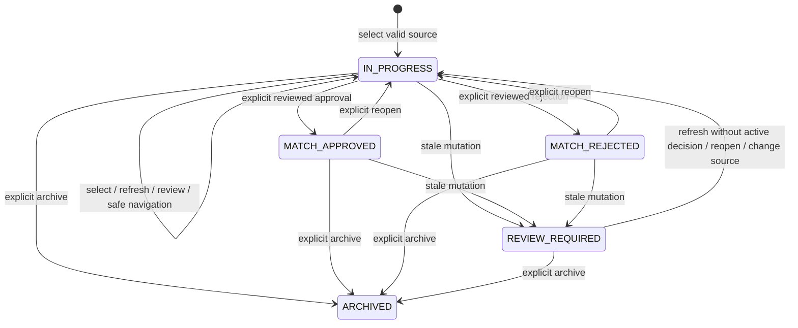

# Human workflow contract — Stages 6–7

The five steps are Select Customer, Review Matches, Read Explanation, Generate Email, and Choose Delivery. Stage 7 makes steps 4/5 entry points to local encrypted drafts and separate exact-email approval/dispatch/evidence. Match approval permits drafting for that current pair; it never authorizes sending. See [email-delivery.md](email-delivery.md) for the independent email contract.

## Central state and invariants

Pure rules live in `src/domain/workflow.ts`. The server calls these rules and verifies the database evidence inside its transaction. A current decision is the latest append-only event, never an extra profile approval flag.

| Status | Steps | Meaning |
| --- | --- | --- |
| IN_PROGRESS | 1–3 | No active decision; selected snapshot may await explicit review |
| MATCH_APPROVED | 1–5 | A human approved the exact reviewed current snapshot; earlier steps can be revisited |
| MATCH_REJECTED | 1–3 | A human rejected the reviewed snapshot; draft/delivery previews stay locked |
| REVIEW_REQUIRED | 1–3 | Current evidence differs; review is cleared and previews are locked; source/candidate back-navigation is allowed |
| ARCHIVED | Stored step | Read-only history; active source uniqueness is released |

Steps 3–5 require a selected snapshot. Steps 4–5 additionally require current human approval and matching review evidence. Review cannot exist without a snapshot. Review, match approval, exact email approval and dispatch remain separate actions. Provider delivery evidence does not automatically complete/archive a match workflow; its independent status appears in Email.

## Evidence, decisions and invalidation

A Workflow holds source/candidate references, initial source revision, selected snapshot, current step/status, authenticated review actor/time, optimistic revision and timestamps. AssessmentSnapshot contains only pair IDs, deterministic score/completeness/factors/eligibility, algorithm/weight/profile/preference versions, a pair-bound SHA-256 stamp and time. It never contains complete profiles, contact values, biographies, photos, prompts or AI output.

MatchDecision records APPROVED, REJECTED or REOPENED, exact pair/snapshot, authenticated actor, explicit review time for approval/rejection, sequence and timestamp. Sequence is the workflow revision of that event and can have gaps caused by other workflow operations. Reopen references the original decision's snapshot, appends history, clears the selected snapshot/review, moves to step 2 and requires a fresh snapshot and reading. A rejected or approved pair cannot be replaced, refreshed or source-switched until reopened. Rationale entry is deliberately absent.

Source selection requires active, valid matching facts, valid stored preferences and an adult age confirmed within Stage 5's 365-day interval. Candidates use Stage 5's same-classification eligibility and ranking, ten per signed page. A selection stamp is an expected-evidence assertion, never authority: the server recomputes it for that exact pair before saving a new snapshot.

Every review, decision and navigation checks current pair evidence. Recalculation uses the same pure Stage 5 assessment and settings read inside the workflow transaction. Both global profile revisions, both preference revisions, weights version, algorithm version, status and all hard-rule evidence must still match. Global revisions conservatively invalidate even contact/consent or other non-scoring edits. Time-dependent age eligibility is recalculated on each check. Soft-factor missingness remains disclosed and may be reviewed deliberately; unresolved hard-rule evidence cannot be approved.

GET returns a projected REVIEW_REQUIRED state for stale evidence and clears its review in the DTO, without mutating business records or audits. An explicit stale review/decision/navigation attempt commits invalidation, increments revision, logs WORKFLOW_STALE once, then returns STALE_ASSESSMENT. It does not retry approval. Old snapshots/decisions remain historical; an active decision must be reopened before refreshing. Once refreshed, a fresh human review and separate decision are required.

Back-navigation saves only the viewing step and preserves a valid pair, review and approval. Source change clears candidate/snapshot/review; candidate change creates a new snapshot and clears review. Old snapshot history remains. Refresh/reopen/source operations check current source/pair inputs, and never auto-approve. Rejection applies to this workflow; it is not a global permanent blacklist. Archiving permits a separate new journey with its own fresh review.

## Persistence and deletion

Migration `202610090002_stage6` is additive: Workflow, AssessmentSnapshot and MatchDecision only. Partial uniqueness permits one non-archived workflow per source. Indexed status/time, source/pair, candidate and event sequence support bounded lists/history. CHECK constraints reject self-matches, conflicting state/step/review fields and invalid statuses/revisions. Triggers prevent REAL/DEMO mixing, bind selected snapshots and decisions to the exact workflow/pair/review, and forbid snapshot/decision updates and direct history deletion.

Source and selected candidate foreign keys cascade on confirmed permanent profile deletion. Workflow deletion cascades its snapshots/decisions; child deletion triggers allow only that parent cascade. This deliberate privacy deletion exception preserves the Stage 4 permanent-delete and DEMO reset controls. Archive retains history. Sanitized AuditEvent rows survive profile/workflow deletion. Snapshot historical pair IDs and decision actor IDs are immutable metadata without mutable profile/user foreign keys; the actor is always derived from the live authenticated session. Deleting a previous source after an explicit source switch does not erase a different current journey.

Demo reset counts workflow/snapshot/decision dependents and binds its confirmation token to demo profile AND workflow revisions. Only DEMO source contexts cascade; REAL workflows and decisions remain. No whole-database reset or legacy data migration exists.

## Protected API

| Method/path beneath /api/workspace | Operation |
| --- | --- |
| GET workflows?page=1 | Authorized newest-first list, 20/page |
| GET workflows/:id | Minimal current detail and latest 100 history events; earlier events remain stored |
| POST workflows | sourceId and sourceRevision; create active context |
| POST workflows/:id/candidates | Optional signed cursor; read-only Stage 5 ranking plus pair-bound selection stamps |
| PATCH workflows/:id | Strict action union: source, candidate, refresh, review, approve, reject, reopen, navigate, archive |

Every service independently authenticates. Existing route defenses enforce exact Origin, bounded JSON and allowlisted methods. Commands require expected workflow revision. Review requires REVIEWED; approve/reject require exact snapshotId and APPROVE MATCH / REJECT MATCH; reopen/archive require their explicit confirmations. Scores, records, actors, eligibility and arbitrary version fields are rejected. IDs are validated UUIDs; references must belong together.

All mutation, snapshot, decision and audit writes are transactional with a final revision compare-and-swap. One concurrent decision wins; repeats or stale tabs conflict safely. No GET approval endpoint exists, page rendering creates nothing, and the Gemini gateway cannot call workflow mutations. API errors expose safe categories: UNAUTHORIZED/FORBIDDEN, NOT_FOUND, INELIGIBLE, STALE_ASSESSMENT, ASSESSMENT_MISMATCH, INVALID_TRANSITION, CONFLICT, CONFIGURATION. Unknown errors remain safe generic failures without SQL or stacks.

Audits: WORKFLOW_CREATED, WORKFLOW_SOURCE_SELECTED, WORKFLOW_CANDIDATE_SELECTED (including refresh), WORKFLOW_REVIEWED, MATCH_APPROVED, MATCH_REJECTED, MATCH_REOPENED, WORKFLOW_STALE, WORKFLOW_STEP_CHANGED, WORKFLOW_ARCHIVED. Fields contain IDs, workflow revision, applicable algorithm/weight/profile/preference revisions and a bounded outcome. No field values, contacts, free-form rationale or AI text are logged. Profile deletion/demo reset audits identify dependency categories removed.

The optional Stage 5 explanation component remains available as a separately labeled transient current explanation with fresh EXPLANATION scope checks. It never supplies approval evidence by itself. The workflow's saved deterministic snapshot is the reviewed authority; decision revalidation catches any intervening change.

## Limits and Stage 7 dependencies

Local SQLite and one operator remain the deployment assumptions. Lists show 20 workflows/page and the latest 100 decision events per detail; older history is retained. Sources/ranking keep Stage 5’s 200/1,000 limits. Stage 7 adds local/manual drafting without an AI request, and independent exact human approval/dispatch. EMAIL_DRAFT remains an independent AI-processing scope; no email free text is sent through the consent gateway. There is no scientific-validation or screen-reader certification claim.

Stage 7 deletion extension: editable EmailDraft rows cascade with profiles/workflows. Encrypted approved EmailDelivery records, attempts and minimal provider-event evidence retain original IDs independently, with their optional draft reference set null. This preserves uncertainty and durable duplicate protection beyond provider retention; the UI explains retention. Deleted/archived/currently invalid workflows cannot authorize another submission, while their retained deliveries remain manually reconcilable. Full retention/purge/key-rotation and scheduled reconciliation are not implemented.
